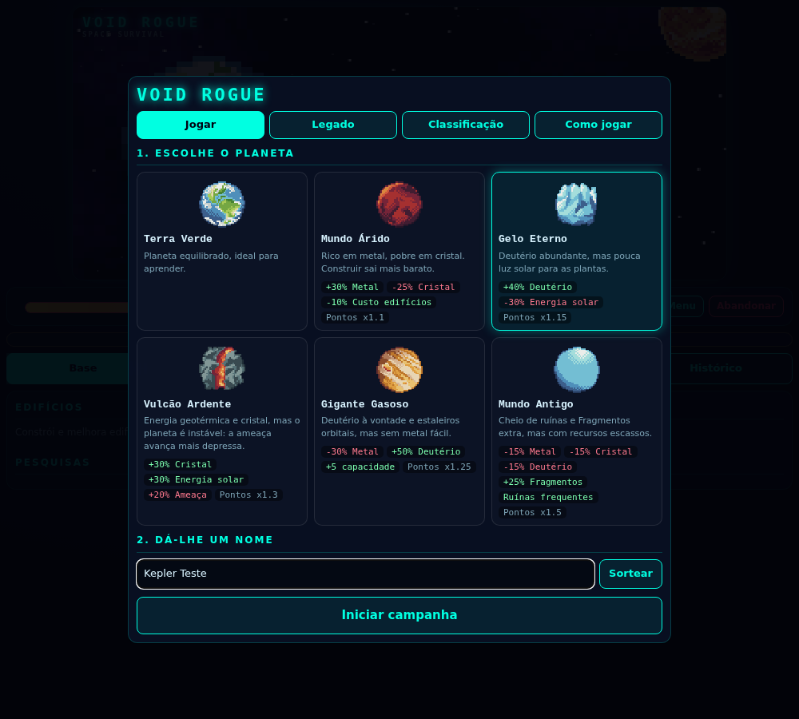
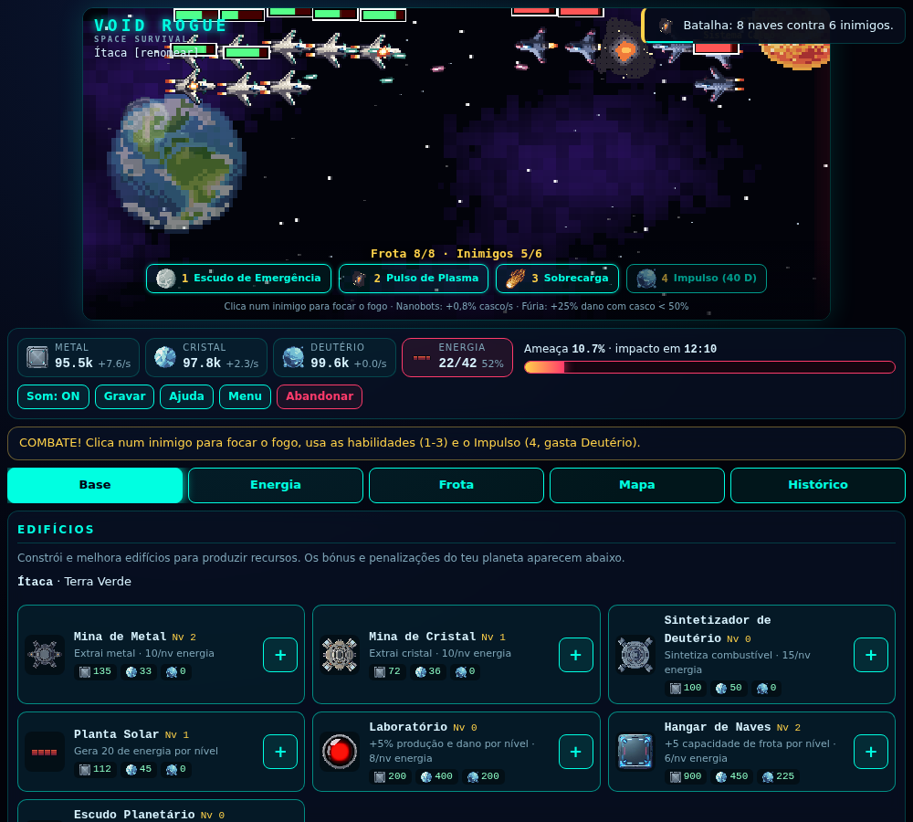

# Void Rogue: Space Survival

Jogo de browser **100% offline** que mistura a gestão de recursos em tempo real do *OGame* com a sobrevivência rogue-like do *FTL*. Constrói uma base, cria uma frota, combate em tempo real e salta de sistema em sistema antes que a anomalia te alcance.

### [▶ Jogar agora](https://bolinhared.github.io/VoidRogueProject/)

> O link funciona depois de ativares o GitHub Pages (ver [Publicar](#publicar-no-github-pages)). Sem Pages, abre o `index.html` diretamente no browser.




## Como se joga

1. **Escolhe um planeta** e dá-lhe um nome. Cada planeta tem bónus e penalizações.
2. **Gere a economia:** as minas produzem Metal, Cristal e Deutério, mas gastam energia. Constrói Plantas Solares e usa o separador **Energia** para ligar/desligar instalações.
3. **Constrói um Hangar** e uma frota. A capacidade é limitada e as perdas são permanentes na campanha.
4. **Explora o mapa** (gasta Deutério): asteroides, mercadores, ruínas, anomalias, sinais de socorro e combates.
5. **Salta de sistema** com 3 setores explorados e Deutério suficiente. Sobrevive a **10 saltos** até ao Centro da Galáxia.
6. A barra de **Ameaça** só começa a subir depois da primeira ação e sobe mais depressa quanto mais energia consumires. A 100%, ataque massivo.
7. Se perderes, ganhas **Fragmentos Quânticos** para o Legado e o resultado entra no **Quadro de Classificação**.

### Combate
Em tempo real. **Clica num inimigo** para focar nele o fogo da frota.

| Tecla | Habilidade | Efeito |
|---|---|---|
| 1 | Escudo de Emergência | Imunidade durante 5 s |
| 2 | Pulso de Plasma | Dano em área a todos os inimigos |
| 3 | Sobrecarga | +60% de dano durante 6 s |
| 4 | Impulso | Gasta Deutério: -6 s nas recargas e cadência dupla durante 4 s |

Passivas: nanobots (+0,8% de casco por segundo) e fúria (+25% de dano com casco abaixo de 50%).

### Planetas
| Planeta | Vantagens | Desvantagens |
|---|---|---|
| Terra Verde | Equilibrado | — |
| Mundo Árido | +30% metal, edifícios -10% | -25% cristal |
| Gelo Eterno | +40% deutério | -30% energia solar |
| Vulcão Ardente | +30% cristal, +30% energia solar | Ameaça +20% mais rápida |
| Gigante Gasoso | +50% deutério, +5 capacidade | -30% metal |
| Mundo Antigo | Muitas ruínas, +25% Fragmentos | -15% em todos os recursos |

Planetas mais difíceis dão um multiplicador de pontos maior.

### Modificadores de sistema
O Sistema 1 é calmo; a cada salto entra um modificador aleatório: Iónico, Cemitério Estelar, Nebulosa Densa, Cinturão Rico, Tempestade Gravítica ou Território Pirata.

### Pontuação
`(saltos × 1000 + segundos sobrevividos + fragmentos × 50) × multiplicador do planeta`, mais 5000 se vencer. 1 dia = 60 s de jogo. O quadro e o progresso ficam guardados no `localStorage` do browser (neste dispositivo).

## Instalar no telemóvel (PWA, ecrã inteiro)
1. Abre o link do jogo no **Firefox para Android** (tem de ser HTTPS, como o GitHub Pages).
2. Menu ⋮ → **Instalar** (ou "Adicionar ao ecrã principal").
3. O atalho abre o jogo sem barra de endereços, em ecrã inteiro (`display: fullscreen` no `manifest.webmanifest`). Em alguns telemóveis o Firefox abre em modo "standalone": usa o botão **Ecrã inteiro** do jogo.
4. Depois da primeira visita o jogo funciona **offline** (`sw.js`). Ao publicar uma versão nova, muda `CACHE` em `sw.js`.

## Estrutura do projeto
```
index.html          página principal (ordem dos scripts comentada)
manifest.webmanifest + sw.js + icon-*.png   instalação como app e modo offline
css/style.css       tema sci-fi, responsivo (PC e mobile)
js/config.js        dados: edifícios, naves, planetas, modificadores, legado, habilidades
js/state.js         estado, custos, pontuação, gravação e tempo offline
js/economy.js       produção, energia (ligar/desligar), ameaça, tick de 1 s
js/audio.js         música sintetizada por fase (calma/tensa/batalha) e efeitos
js/combat.js        combate em tempo real, foco de fogo, habilidades, impulso
js/map.js           nodos do sistema, eventos e ações do jogador
js/scene.js         ecrã superior em canvas (planeta, frota, batalha)
js/ui.js            painéis, notificações, histórico, menu, legado, classificação
js/assets.js        manifesto dos sprites (gerado por prep_assets.py)
js/main.js          arranque e ciclo de jogo
assets/             sprites PNG
docs/               imagens deste README
prep_assets.py      (opcional) regenera assets/ e js/assets.js a partir dos packs originais
build.py            (opcional) gera void-rogue-standalone.html com tudo embutido
```

## Correr localmente
Abre o `index.html` no browser (funciona por `file://`, sem servidor nem dependências). JavaScript puro (ES6+), sem bibliotecas.

## Publicar no GitHub Pages
1. Faz commit de **tudo**, mantendo as pastas `css/`, `js/`, `assets/` e `docs/`.
2. No repositório: **Settings → Pages → Branch `main` / pasta `/ (root)` → Save**.
3. Ao fim de um minuto o jogo fica em `https://bolinhared.github.io/VoidRogueProject/`.

## Créditos e licenças
- Sprites: *Cozy Space Ships* (Bramble & Byte), *Pixel Planets Pack*, *Space Pack* e *Spaceship Pack*.
- Música e efeitos sonoros: sintetizados em código (WebAudio), sem ficheiros de áudio.
- **Atenção:** as licenças dos packs permitem usar os sprites em jogos, mas **não** revendê-los nem redistribuí-los como pacote de assets. Um repositório público com os PNG em bruto pode contar como redistribuição, por isso confirma os termos de cada pack antes de manter o repositório público.
